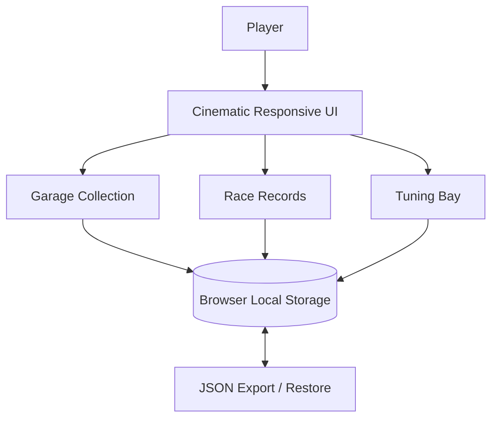

# GT6 Garage Companion

[](https://github.com/zopair/GT6-Garage-Companion)
[](LICENSE)
[](#architecture)

An independent, offline-first motorsport companion concept for Gran Turismo 6 players. It brings a personal car collection, race history, and tuning notebook into a cinematic, game-inspired garage interface.

> **Project status:** Proof of Concept. Independent fan-made concept; not affiliated with, endorsed by, or sponsored by Sony Interactive Entertainment or the Gran Turismo franchise. Gran Turismo is a trademark of its respective owner. The interface uses original CSS/SVG artwork and does not bundle game assets.

## Experience

- **Cinematic garage:** original vector performance-car artwork, atmospheric lighting, motion accents, and responsive racing-inspired presentation.
- **Garage collection:** organize cars and user-entered specifications.
- **Race records:** track events, finishing positions, and lap times.
- **Tuning bay:** save named setup notes against a selected car.
- **Personal archive:** export and restore the garage as JSON.
- **Offline-first:** no account, hosted backend, paid API, external image dependency, or runtime package dependency.

## Architecture



## Quick start

Requirements: Node.js 20+ for tests and Python 3 for the local static server.

```bash
git clone https://github.com/zopair/GT6-Garage-Companion.git
cd GT6-Garage-Companion
git switch feature/garage-simulator-ui
npm test
npm run serve
```

Open `http://localhost:8080`. Data stays in the current browser profile until the user exports it.

## Proof of Concept & Enterprise Customization Readiness

- [x] Responsive racing-inspired interface
- [x] Original inline SVG hero artwork (no third-party image dependency)
- [x] Garage, race, and setup workflows
- [x] Local persistence and JSON backup/restore
- [x] Reduced-motion accommodation
- [ ] Full browser/device QA and accessibility audit
- [ ] Optional GitHub Pages deployment

**Customization readiness:** The client-side structure and portable JSON data format provide a low-complexity foundation for future extensions without requiring a server or paid services.

## Data accuracy

Car specifications, PP values, event requirements, and tuning behavior are user-entered or independently verified data. This project does not claim to reproduce the game's physics or calculate authoritative in-game performance.

## Changelog

- **2026-11-25** — Reworked the interface into a cinematic, responsive motorsport garage experience; added original SVG car artwork and removed external visual dependencies.

## Intellectual Property & Authorship

Original project concept, architecture, and implementation authored by **Aly Hussein Zopair (علي حسين زبير ALY HUSSEIN ZOPAIR)**.

The MIT license applies to original code where included. Third-party names and trademarks remain the property of their respective owners.
