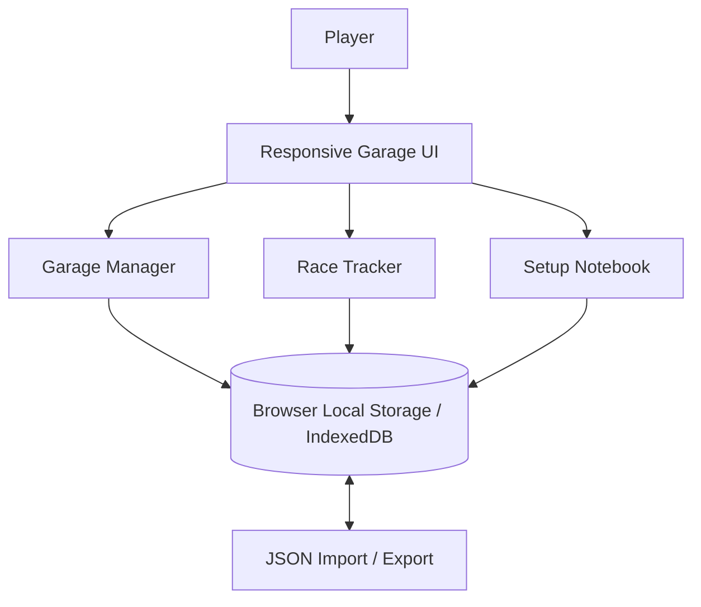

# GT6 Garage Companion

An offline-first garage and race companion for Gran Turismo 6 players. Track a personal car collection, organize race results, and keep versioned tuning notes in one lightweight interface.

> **Project status:** Proof of Concept. This is an independent, community-oriented companion concept and is not affiliated with, endorsed by, or sponsored by Sony Interactive Entertainment or the Gran Turismo franchise. Gran Turismo is a trademark of its respective owner. No game assets or proprietary data are included.

## Business problem

Players often keep garage details, tuning experiments, and race results across scattered notes or spreadsheets. That makes it difficult to compare setups, remember what worked on a track, and follow progress over time.

## Proposed solution

A responsive, local-first workspace that brings together:
- **Garage Manager** — organize cars and record user-entered specifications.
- **Race Tracker** — record events, results, lap times, and personal progress.
- **Setup Notebook** — save and compare tuning configurations.
- **Track & Race Planner** — keep personal notes about event requirements.

All records are intended to remain on the user's device, with import/export for backup and portability. No account, hosted backend, paid API, or subscription is required.

## Architecture

## Quick start

The application implementation is being developed on a dedicated feature branch. Once the first runnable version is available, this section will contain the exact local setup and run commands.

## Proof of Concept & Enterprise Customization Readiness

- [x] Repository initialized
- [ ] Garage interface and navigation
- [ ] Local persistence and backup/restore
- [ ] Race result tracking
- [ ] Versioned tuning notes
- [ ] Automated tests and accessibility checks
- [ ] Optional GitHub Pages deployment

**Customization readiness:** The MVP will use modular, client-side components and portable data formats so that future integrations can be evaluated without introducing server or paid-service dependencies.

## Data accuracy

Car specifications, PP values, event requirements, and tuning behavior must be treated as user-entered or independently verified data. The application will not claim to reproduce the game's physics or calculate authoritative in-game performance unless validated evidence and permitted data sources are available.

## Changelog

- **2026-11-25** — Repository initialized; approved implementation branch to follow.

## Intellectual Property & Authorship

Original project concept, architecture, and implementation authored by **Aly Hussein Zopair (علي حسين زبير ALY HUSSEIN ZOPAIR)**.

The repository's MIT license applies to original code where included. Third-party names and trademarks remain the property of their respective owners.
